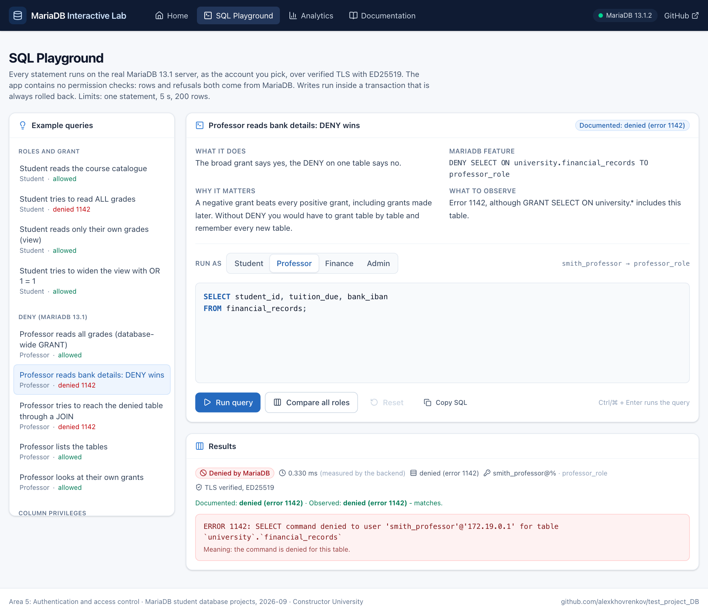
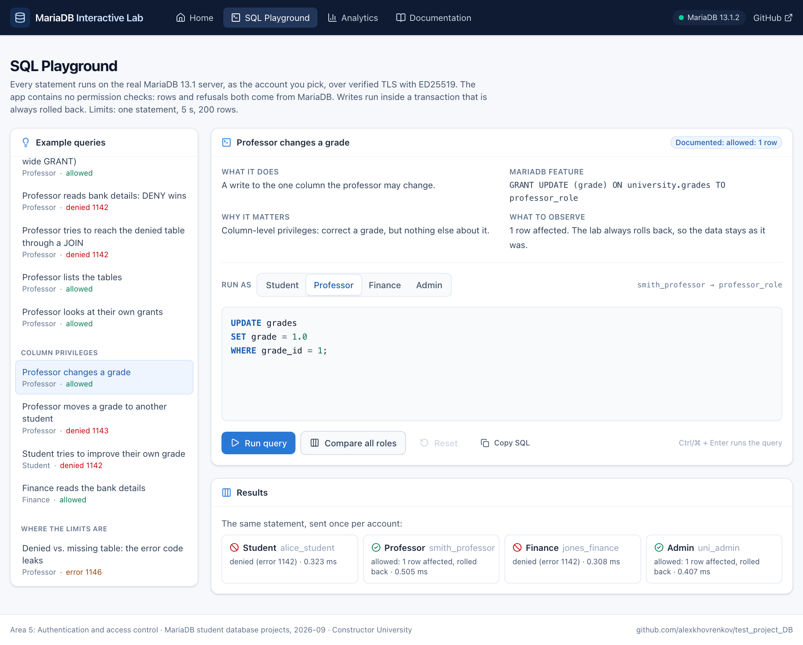
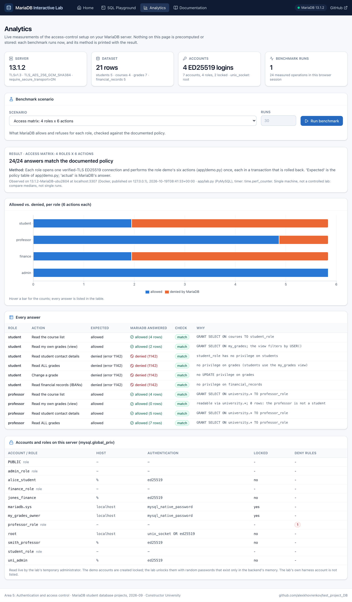
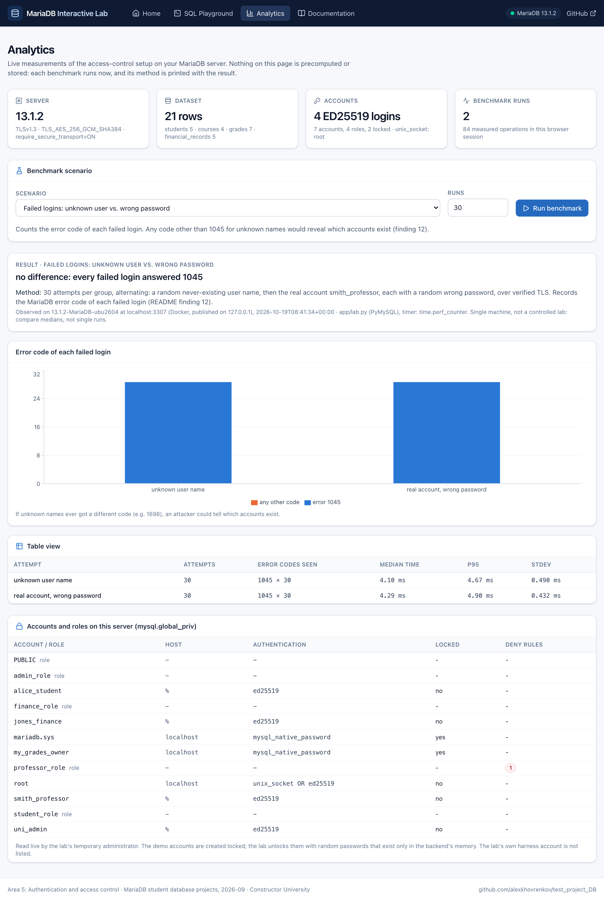
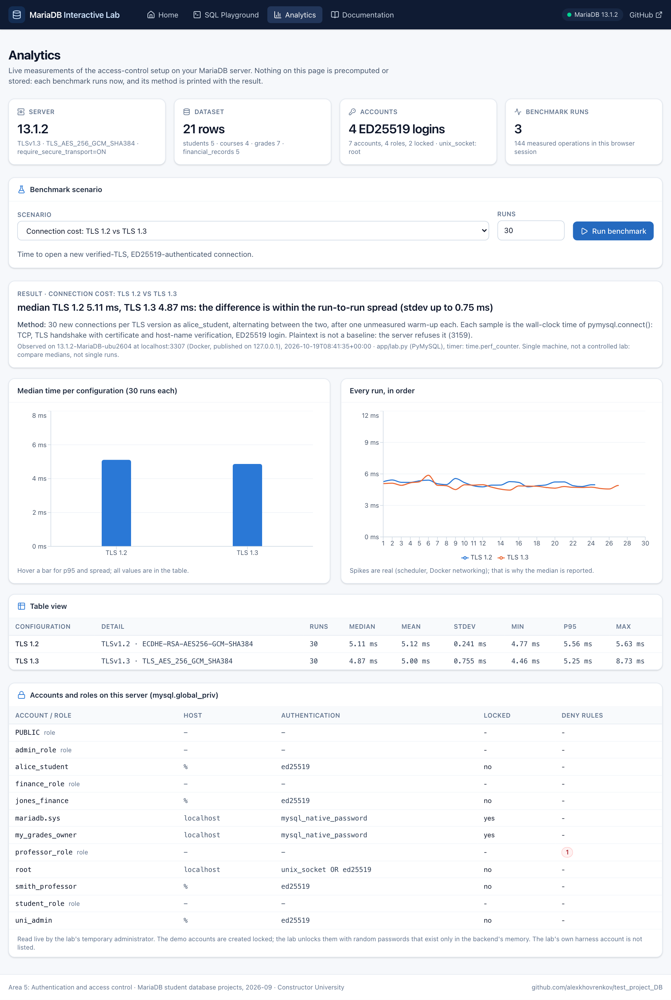

A project for area 5, "Authentication and access control" for the [MariaDB student database projects, 2026-09](https://mariadb.org/bachelor_hackathon_2026-09/).

# Protecting a University Database with MariaDB 13.1: Roles, DENY, ED25519 and Verified TLS

[](https://github.com/julymichy14/CU-DB---Auth-Access-Control-Project/actions/workflows/ci.yml)

**Constructor University** · **Repository:** <https://github.com/julymichy14/CU-DB---Auth-Access-Control-Project> · **Branch:** `main`
**MariaDB version:** 13.1.2 (`13.1.2-MariaDB-ubu2604`, a preview release). [docker-compose.yml](docker-compose.yml) uses,
by default, the exact build all results below come from:
`quay.io/mariadb-foundation/mariadb-devel@sha256:f4c4cbe40c3c0662e6d7287cd0b17758cdca06cff87f178f307dc7d1f65b86f8`.
If the registry stops serving that digest, use the `13.1` tag instead (see section 3).

```bash
git clone https://github.com/julymichy14/CU-DB---Auth-Access-Control-Project.git && cd CU-DB---Auth-Access-Control-Project
make demo      # certificates, MariaDB 13.1, every demonstration (no password to configure)
make test      # 353 tests: 157 unit + 196 integration tests against the real server
make lab       # MariaDB Interactive Lab in the browser: SQL playground as each role, live analytics
```

[](docs/interactive-lab.md)

## Contents

1. [Overview and objectives](#1-overview-and-objectives)
2. [Why MariaDB, and why 13.1](#2-why-mariadb-and-why-131)
3. [Requirements and quick start](#3-requirements-and-quick-start)
4. [Scenario, schema and design decisions](#4-scenario-schema-and-design-decisions)
5. [Architecture](#5-architecture)
6. [What we built and what we found](#6-what-we-built-and-what-we-found)
7. [Which control stops which attack](#7-which-control-stops-which-attack)
8. [Test results and CI](#8-test-results-and-ci)
9. [What is still unprotected](#9-what-is-still-unprotected)
10. [Team](#10-team)
11. [More documentation and references](#11-more-documentation-and-references)

---

## 1. Overview and objectives

A **hands-on, executable tutorial** for MariaDB's security features. It builds a small fictional university
database that holds things worth protecting (grades, bank details) and then:

* controls who may do what with **roles**, **`GRANT`** and the new **`DENY`** statement (MariaDB 13.1),
* stores **no password in any file**: root uses **`unix_socket`**, people log in with **ED25519**, automated runs
  keep passwords in memory only, and the run's administrator also needs a **client certificate** (`REQUIRE X509`),
* forces every connection through **TLS** and **verifies** the server certificate and host name,
* **attacks** each control (14 experiments, 353 tests) and shows which mechanism stopped which attack,
* puts it in a browser: the **Interactive Lab** runs 21 prepared statements - or your own - *as* each of the four
  accounts and measures the setup live.

The Python code only sends SQL and prints MariaDB's answer. **All security decisions are made by MariaDB**;
there is no `if user == "professor"` anywhere.

| Area 5 brief | Where it is done and shown |
|---|---|
| Roles and `DENY` doing the work | [sql/03_roles.sql](sql/03_roles.sql); [guide](docs/access-control-guide.md#roles-and-permissions); experiments 1, 2, 8 |
| An authentication method instead of a stored password | `unix_socket` for root, ED25519 (+ X509 for the harness): [sql/04_users.sql](sql/04_users.sql), [sql/06_lockdown.sh](sql/06_lockdown.sh), [app/admin.py](app/admin.py) |
| An attack against each control | section 7; [experiments/](experiments/); [tests/](tests/) |
| TLS verified rather than assumed | [guide](docs/access-control-guide.md#tls-that-is-verified-not-assumed); [tests/integration/test_tls.py](tests/integration/test_tls.py) |
| Reproducible on a fresh server | `make demo`; section 3; verified from a clean copy and in CI (section 8) |
| What stops which attack, what remains unprotected | sections 7 and 9 |

## 2. Why MariaDB, and why 13.1

The project is about MariaDB's own access-control engine; Python is only the client.

| Capability | Why it needs MariaDB |
|---|---|
| **`DENY` / `REVOKE DENY`** (negative grants) | New in **MariaDB 13.1** ([MDEV-14443](https://jira.mariadb.org/browse/MDEV-14443)). MySQL 8 and PostgreSQL have no equivalent: "everything except this table" there means listing every allowed table. Older MariaDB rejects the statement. |
| **`ed25519` authentication** | Ships with MariaDB; the server stores only a *public key*, so a stolen `mysql.user` cannot be replayed. MySQL has no such plugin. |
| **`unix_socket` authentication** | The OS user *is* the credential: `root@localhost` has no password and works only inside the container. |
| **MariaDB role model** (one active role, roles inside roles) | Differs from MySQL 8 and PostgreSQL; experiments 2 and 8 depend on these semantics. |
| **Privileges as JSON in `mysql.global_priv`** | DENYs live in its `denies` key; `FLUSH PRIVILEGES` rebuilds the role graph (finding 1). |
| `ACCOUNT LOCK`, `PASSWORD EXPIRE`, `require_secure_transport`, `PUBLIC`, password-validation plugins | Used in the authentication, TLS and policy tests. |

**How the layers fit.** Classic GRANTs are *additive*; with DENY the model has a **ceiling**: no later GRANT lifts
it, only an explicit `REVOKE DENY` does, so "professors never read bank details" survives future admin mistakes
(with the caveats in the findings). ED25519 proves *who* connects without a reusable secret and `unix_socket`
removes the password for root altogether. **Verified TLS** protects the channel *and* the server's identity:
encryption alone ends up at an impostor just as happily (PyMySQL 1.2's default encrypts but does not verify).
Each layer fails differently and none replaces another.

## 3. Requirements and quick start

**You need:** Docker with Compose (Docker Desktop on macOS/Windows), Python 3.10+ (tested with 3.13), `make`,
`openssl`, `bash`; for `make lab` also Node.js 20+ (tested with 22). On Windows use WSL. Developed on macOS
(Apple silicon) with Docker 29; CI runs on x86_64 Ubuntu (section 8).

```bash
git clone https://github.com/julymichy14/CU-DB---Auth-Access-Control-Project.git
cd CU-DB---Auth-Access-Control-Project
make demo
```

`make demo` is safe to repeat and asks for nothing. It generates a CA plus server and client certificates, starts
MariaDB 13.1 with TLS required (on first start [sql/](sql/) creates schema, data, roles and *locked* users and
switches root to `unix_socket`), creates a virtual environment, creates a short-lived administrator, and runs the
role demo, 5 tutorial examples and experiments 1-13 (output in [docs/demo-output.txt](docs/demo-output.txt)). Every
step prints `PASS`/`FAIL`; any failure makes `make` exit non-zero. New to the project? Start with
[examples/README.md](examples/README.md) (10 minutes).

> **If `make demo` stops at the image pull** (`manifest unknown`): the default image is a preview build pinned by
> digest, and the registry may stop serving a digest (it happened once). Use the floating tag: `cp .env.example .env`,
> uncomment `MARIADB_IMAGE=quay.io/mariadb-foundation/mariadb-devel:13.1`, run `make demo` again. Behaviour is the
> same on every 13.1.x build tested (the CI "canary" job checks weekly).

| Command | Does |
|---|---|
| `make test` / `make unit` | all 353 tests with coverage / only the 157 unit tests (no server needed) |
| `make lab` | the Interactive Lab at <http://127.0.0.1:8000> ([docs/interactive-lab.md](docs/interactive-lab.md)) |
| `make lockout` | experiment 14 on its own disposable server |
| `make set-password USER=smith_professor` | choose a password for a demo account (typed, never stored) |
| `make sql USER=smith_professor` / `make shell` | `mariadb` client as that account / as root through the container socket |
| `make lint` / `make frontend-test` | ruff + shellcheck / frontend type check and unit tests |
| `make down` / `make reset` / `make clean` | stop / stop and delete data / also delete certs, venv and build |

Without `make`, on Windows, with a port clash, or when something fails: [docs/reproduce-and-test.md](docs/reproduce-and-test.md).

## 4. Scenario, schema and design decisions

A small university keeps four kinds of information in one database, `university`. Four kinds of people use it
(all names and data are made up):

| Person | MariaDB account | Role |
|---|---|---|
| Alice, a student | `alice_student` | `student_role` |
| Prof. Smith | `smith_professor` | `professor_role` |
| Mr. Jones, finance office | `jones_finance` | `finance_role` |
| The database administrator | `uni_admin` | `admin_role` |

```
 students                     courses
 ─────────────────            ─────────────────
 student_id  PK  ◄──┐  ┌────► course_id   PK
 first_name         │  │      code, title, credits, professor
 last_name          │  │
 email              │  │      financial_records
 program            │  │      ─────────────────
 db_username UNIQUE │  │      record_id   PK
                    │  │      student_id  FK ──► students
 grades             │  │      tuition_due, amount_paid
 ─────────────────  │  │      scholarship
 grade_id    PK     │  │      bank_iban   (fake)
 student_id  FK ────┤  │
 course_id   FK ────┼──┘      my_grades (VIEW): one student's own rows
 grade  DECIMAL(2,1)         (rows where students.db_username = the connected user)
```

Files: [sql/01_schema.sql](sql/01_schema.sql), [sql/02_data.sql](sql/02_data.sql). Design decisions:

* **Tables differ in sensitivity on purpose**: `courses` is public catalogue data, `students` is personal
  data, `grades` is *read by many but written by few*, `financial_records` is the crown jewel. That gives
  the access-control model something real to separate (read-only vs read-write, row-level vs table-level).
* **`students.db_username`** links a person to a MariaDB account, so the `my_grades` view can filter by
  `USER()`. This is MariaDB doing row-level security with a view, not Python code.
* **Foreign keys** keep the data honest (MariaDB refuses a grade for a missing student, error 1452).
* **`grade DECIMAL(2,1)`** (German 1.0-5.0 scale) so a column-level privilege on `grade` is meaningful:
  a professor may change *the grade* but not *whose grade it is* (`student_id`).
* **`my_grades` is defined by a dedicated account**, `my_grades_owner`: `ACCOUNT LOCK`, host `localhost`
  only, `SELECT` on three tables. A definer view lends the definer's rights to every reader (experiment 9),
  so the definer is as small as possible instead of `root`.

## 5. Architecture

```
  python app/demo.py ───────────┐
  python app/menu.py ───────────┤
  browser ─► app/lab_server.py ─┼──►  app/database.py ══ TLS 1.2/1.3, server cert verified ══►  MariaDB 13.1 (Docker)
  (frontend/, make lab)         │     (ED25519 login,                                        ├─ require_secure_transport=ON
  pytest (tests/) ──────────────┤      ssl_verify_cert + identity,                           ├─ roles / GRANT / DENY decide every query
  app/sqlrunner.py ─────────────┘      client cert for the harness)                          ├─ password policy plugins
         ▲                                                                                   └─ mysql.global_priv holds the rules
         │                                                                                            ▲
  examples/*.sql, experiments/*.sql                                                                   │ unix_socket, no password
  (annotated SQL; each step states             app/admin.py ── docker exec ... mariadb (root) ────────┘ (creates/drops the
   what MariaDB must answer)                                                                           short-lived harness)
```

* [app/database.py](app/database.py): connections with ED25519, `ssl_verify_cert` and `ssl_verify_identity`; passwords
  from memory or `getpass`, never a file. **No permission logic**; values reach SQL only as `%s` parameters.
* [app/admin.py](app/admin.py): talks to socket-authenticated root through `docker exec`, creates and drops each run's
  short-lived administrator, implements `make set-password`.
* [app/demo.py](app/demo.py), [app/sqlrunner.py](app/sqlrunner.py): run the same actions as each role / the annotated
  `.sql` files as the user named in each step, and compare with the stated expectation. pytest runs them too, so the
  documentation cannot drift from reality.
* [app/lab_server.py](app/lab_server.py), [app/lab.py](app/lab.py), [frontend/](frontend/): the Interactive Lab (a
  standard-library API on `127.0.0.1` plus a React/TypeScript app that holds no credential).
* [tests/unit/](tests/unit/) need no server; [tests/integration/](tests/integration/) run against the real one.
* [docker-compose.yml](docker-compose.yml): MariaDB with TLS; the port is published on `127.0.0.1` only.

## 6. What we built and what we found

**Roles** ([sql/03_roles.sql](sql/03_roles.sql); every cell is checked by `make roles` and `test_role_matrix`, 24 combinations):

| Role | `courses` | `students` | `grades` | `my_grades` view | `financial_records` |
|---|---|---|---|---|---|
| `student_role` | Read | No | No | Read (own rows only) | No |
| `professor_role` | Read | Read | Read + update the **`grade` column only** | Read | **DENIED** |
| `finance_role` | No | Read | No | No | Read / insert / update |
| `admin_role` | All | All | All | All | All - but only inside `university.*` |

**DENY**: grant broadly, then subtract. A DENY beats every GRANT at every level, in either order.

```sql
GRANT SELECT ON university.* TO professor_role;                  -- "read everything..."
DENY  SELECT ON university.financial_records TO professor_role;  -- "...except this table"
-- as smith_professor:  SELECT * FROM financial_records;
-- ERROR 1142 (42000): SELECT command denied to user 'smith_professor'@'localhost' for table `university`.`financial_records`
```

**Authentication without a password file.** root: `unix_socket` (no password; `docker exec` only, no `root@'%'`). The
four demo accounts: ED25519, created `ACCOUNT LOCK`ed with an unusable key; a person sets a password with
`make set-password`, an automated run uses a random one that lives only in memory. The run's administrator
(`harness_<hex>`): ED25519 + `REQUIRE X509`, dropped at the end. Password-validation and reuse plugins are on. Tests
confirm that no live password is in any file, the container environment or the server log.

**TLS that is verified.** Our own CA; server and client verify chain *and* host name; TLS 1.2/1.3 only;
`require_secure_transport=ON`. A client trusting another CA, or connecting to `127.0.0.1` instead of `localhost`, is
refused by the client; plaintext is refused by the server (error 3159); verification switched off connects - the lesson.

Details, real output and the full attack tables: [docs/access-control-guide.md](docs/access-control-guide.md).

**Twelve findings** (all reproduced on 13.1.2, each by an experiment or a test; full text in
[docs/experiments-and-findings.md](docs/experiments-and-findings.md)):

1. A DENY on an inherited role is **not enforced until `FLUSH PRIVILEGES`** (fail-open window); [bug report](docs/upstream-report-nested-role-deny.md) prepared, not filed.
2. A DENY attached to a role vanishes with `SET ROLE NONE` if another path still grants the privilege.
3. A DENY on the viewer does not follow a `SQL SECURITY DEFINER` view.
4. A column DENY hides data, not the column's existence.
5. Error codes (1142 vs 1146) reveal that a denied table exists.
6. Database names in GRANT/DENY are patterns (`_` is a wildcard); a pattern DENY can silently do nothing.
7. DENYs outlive `DROP DATABASE`.
8. `DENY ... TO PUBLIC` can lock out every administrator; with `UPDATE, DELETE` only `--skip-grant-tables` recovers (`make lockout`).
9. The password reuse history keeps refused passwords and outlives `DROP USER`.
10. One policy violation, two error codes (1819 vs 1396).
11. The policy misses shared passwords, passwords containing the account name, and pre-existing credentials.
12. A `unix_socket`-only account opens a **user-enumeration oracle** (error 1698 vs 1045); fixed by ending root's authentication chain in ed25519.

**The Interactive Lab** (screenshots from a fresh copy; [details](docs/interactive-lab.md)):

| SQL Playground: one statement, four accounts | Analytics: the access matrix, measured live |
|---|---|
|  |  |
| **Analytics: failed logins (finding 12)** | **Analytics: TLS 1.2 vs TLS 1.3, 30 runs each** |
|  |  |

## 7. Which control stops which attack

| Attack | Stopped by | Evidence | Real error |
|---|---|---|---|
| Stranger guesses a password | ED25519 login | [test_authentication.py](tests/integration/test_authentication.py) | 1045 |
| Attacker steals `mysql.user` and replays the stored value | ED25519 stores a public key only | `test_stolen_authentication_string...` | 1045 |
| Account enumeration through error messages | identical error for unknown user / wrong password | `test_unknown_user_and_wrong_password_look_identical` | 1045 |
| Account enumeration through the imitated plugin (finding 12) | root's auth chain ends in ed25519 | `test_unknown_users_are_indistinguishable_from_real_ones` | 1045 (never 1698) |
| Eavesdropping on the connection | TLS | `test_verified_connection_uses_modern_tls` | - |
| Impostor server with its own certificate | CA verification | `test_client_trusting_a_different_ca...` | client: `CERTIFICATE_VERIFY_FAILED` |
| Traffic redirected to the wrong host name | host-name verification | `test_host_name_mismatch_is_refused` | client: `IP address mismatch` |
| Client talking without TLS (also the administrator) | `require_secure_transport` | `test_plaintext_connection_...` | 3159 |
| Student reads grades / finance data | role has no GRANT | `test_role_matrix` | 1142 |
| Student widens the `my_grades` view | filter is inside the view | `test_student_cannot_widen_the_view` | still 2 rows |
| Professor reads bank details (also via JOIN) | **DENY** | `test_professor_join_cannot_reach_the_denied_table` | 1142 |
| Admin "fixes" it with a later GRANT | **DENY beats GRANT** | `test_deny_beats_a_later_table_level_grant` | 1142 |
| Professor reassigns a grade to another student | column-level GRANT | `test_professor_can_change_the_grade_column_only` | 1143 |
| User activates a role they were never given | role grants | experiment 5 | 1959 |
| User grants themselves access / grants to PUBLIC | GRANT OPTION rules | experiment 5 | 1142 |
| Delegated admin unlocks their own DENY | DENY needs the privilege to lift | experiment 5 | 1142 |
| Create accounts, read `mysql.*`, change root's password | global privileges absent | experiments 5, 6 | 1227 / 1142 / 1044 |
| Administrator mistake: `DENY ... TO PUBLIC` on everything | nothing over SQL; recovery needs server access | `make lockout` | 1142 / 1045 |
| User calls a stored procedure/function inside a schema they may execute | routine-level DENY | `test_routine_deny_beats_database_grant_execute` | 1370 |
| Weak password set for an account | `simple_password_check` | `test_weak_passwords_are_refused` | 1819 |
| Old password set again | `password_reuse_check` | `test_reuse_is_refused_by_set_password_with_1819` | 1819 / 1396 |
| Bypass the policy with a pre-computed key | `strict_password_validation` | `test_precomputed_public_key_is_refused...` | 1290 |
| Locked / expired account | `ACCOUNT LOCK`, `PASSWORD EXPIRE` | `test_locked_account...`, `test_expired_password...` | 4151 / 1820 |
| SQL injection through the app | parameters + input validation | `test_update_grade_rejects_injection_payloads` | ValueError / no match |

## 8. Test results and CI

Real runs against `13.1.2-MariaDB-ubu2604` in a **fresh copy** of the repository (no certificates, virtual
environment, `node_modules` or server), with its own container name and port next to the developer's running copy.
`make test`, `make demo` and `make lockout` were repeated on 2026-10-23, after the pinned image was replaced
(quay.io stopped serving the old digest; same 13.1.2 build) and the CA got `keyUsage`.

| Command (fresh copy) | Result |
|---|---|
| `make demo` | exit 0 - role demo **24/24**; tutorial examples **108/108** steps; experiments 1-13 **373/373** steps ([docs/demo-output.txt](docs/demo-output.txt)) |
| `make test` | **353 passed** (157 unit + 196 integration) in about 15 s; coverage of `app/` **96 %** ([docs/test-output.txt](docs/test-output.txt)) |
| `make lockout` | **13/13** steps on a disposable server ([docs/lockout-output.txt](docs/lockout-output.txt)) |
| `make lint`, `make frontend-test frontend` | ruff and shellcheck clean; `tsc` clean, 10 frontend tests, build succeeded (CI run below) |
| `make lab` | all four pages loaded in headless Chromium, every example and benchmark ran, no console errors (2026-10-19; [docs/screenshots/](docs/screenshots/)) |
| two copies side by side | every command passed in the second copy while the first was running |

**CI** ([ci.yml](.github/workflows/ci.yml)) runs on every push to `main` on GitHub's x86_64 Ubuntu runners: lint, the
frontend checks and build, the pinned MariaDB image with TLS, `make test`, `make demo`, `make lockout`; a `canary` job
repeats the tests on the floating `13.1` tag. Green run on commit `f0dc281`:
<https://github.com/julymichy14/CU-DB---Auth-Access-Control-Project/actions/runs/39938923642> (353 passed, demo
373/373, lockout 13/13, canary green). The first run
([39846078638](https://github.com/julymichy14/CU-DB---Auth-Access-Control-Project/actions/runs/39846078638)) failed
because the original image digest had disappeared; the fix is described above and in section 3. The badge at the top
shows the status of the latest commit.

**Do the tests test?** With the professor's DENY revoked, 18 of 353 tests failed; restoring it gave 353 passed again.
With a TLS key set to mode 644 the key-permission test failed. Test files, mutation details and troubleshooting:
[docs/reproduce-and-test.md](docs/reproduce-and-test.md).

## 9. What is still unprotected

* **Anyone who can run `docker exec` on this machine is root in the database** (that is what `unix_socket` means
  here). Protect the Docker daemon like the root password it replaces.
* The harness's client key (`certs/client-key.pem`) is a long-lived secret on disk, protected only by mode `600`.
* During first initialisation root has an empty password for a few seconds, reachable only through the socket of the
  temporary server (no networking); `strict_password_validation` is off for one statement. `make reset` starts over.
* The CA key lives on the same machine as the server; certificates last 365 days; there is no revocation.
* TLS protects data in transit only: not the server host, the Docker daemon, a compromised client, or files at rest.
* Roles and DENY do not restrict root; anyone who becomes root can `REVOKE DENY`.
* Permissions cannot tell use from misuse: finance can copy every IBAN it may read.
* The password policy misses shared passwords, passwords containing the account name, and credentials older than the
  plugins (finding 11).
* The metadata leaks of findings 4 and 5, and a role-attached DENY next to a second source of the same privilege (finding 2).
* MariaDB 13.1 is a **preview** release; finding 1 in particular may change. The verified build is pinned by digest.
* **The Interactive Lab's API has no login of its own**: while `make lab` runs, any program on this computer can send
  it statements (127.0.0.1 only, foreign `Host` headers and non-JSON POSTs refused). They run as the demo accounts, one
  checked statement at a time, always rolled back. Its timings are from one machine, not a controlled benchmark.

Done and tested: keys are mode `600`; no password in any file; no `root@'%'`; least-privilege run administrator;
no password interpolated into SQL; no string-built SQL in `app/`; verified TLS everywhere; port on `127.0.0.1`;
`my_grades` defined by a locked read-only account; passwords never printed.

## 10. Team

| Name | Contribution |
|---|---|
| Alexander Vicente Lopez Yanes | Test scripts |
| Maha Mahdi | Python, Frontend and Evaluation Tests |
| Alexei Khovrenkov | App files and SQL|
| Julissa Michelle Barahona Nunez | Repository, README, Docker management |

## 11. More documentation and references

| Document | Contents |
|---|---|
| [docs/access-control-guide.md](docs/access-control-guide.md) | roles, DENY rules, authentication and password policy, TLS - with real output |
| [docs/experiments-and-findings.md](docs/experiments-and-findings.md) | the 14 experiments and all 12 findings in full |
| [docs/interactive-lab.md](docs/interactive-lab.md) | the web frontend: pages, safety limits, development |
| [docs/reproduce-and-test.md](docs/reproduce-and-test.md) | commands by hand, test files, reproduction table, troubleshooting, repository layout |
| [examples/README.md](examples/README.md) | five standalone SQL lessons, 10-minute start |

Official MariaDB documentation:

* [DENY and REVOKE DENY](https://mariadb.com/docs/server/reference/sql-statements/account-management-sql-statements/deny) (reference: syntax, precedence, metadata effects, limitations)
* [MariaDB 13.1 Feature in Focus: DENY / Negative Grants](https://mariadb.org/mariadb-13-1-feature-in-focus-deny-negative-grants/) · [MDEV-14443](https://jira.mariadb.org/browse/MDEV-14443)
* [MariaDB 13.1 Changes & Improvements](https://mariadb.com/docs/release-notes/community-server/13.1/mariadb-13.1-changes-and-improvements)
* [GRANT](https://mariadb.com/docs/server/reference/sql-statements/account-management-sql-statements/grant) · [REVOKE](https://mariadb.com/docs/server/reference/sql-statements/account-management-sql-statements/revoke) · [SHOW GRANTS](https://mariadb.com/docs/server/reference/sql-statements/administrative-sql-statements/show/show-grants)
* [mysql.global_priv table](https://mariadb.com/docs/server/reference/system-tables/the-mysql-database-tables/mysql-global_priv-table)
* [Roles Overview](https://mariadb.com/docs/server/security/user-account-management/roles/roles_overview) · [CREATE ROLE](https://mariadb.com/docs/server/reference/sql-statements/account-management-sql-statements/create-role)
* [Password Validation Plugins](https://mariadb.com/docs/server/reference/plugins/password-validation-plugins) · [simple_password_check](https://mariadb.com/docs/server/reference/plugins/password-validation-plugins/simple-password-check-plugin) · [password_reuse_check](https://mariadb.com/docs/server/reference/plugins/password-validation-plugins/password-reuse-check-plugin)
* [Authentication Plugin - Unix Socket](https://mariadb.com/docs/server/reference/plugins/authentication-plugins/authentication-plugin-unix-socket)
* [Authentication Plugins](https://mariadb.com/docs/server/reference/plugins/authentication-plugins) · [ed25519](https://mariadb.com/docs/server/reference/plugins/authentication-plugins/authentication-plugin-ed25519) · [PARSEC](https://mariadb.com/docs/server/reference/plugins/authentication-plugins/authentication-plugin-parsec)
* [Secure Connections Overview](https://mariadb.com/docs/server/security/encryption/data-in-transit-encryption/secure-connections-overview) · [Enabling TLS on MariaDB Server](https://mariadb.com/docs/server/security/encryption/data-in-transit-encryption/data-in-transit-encryption-enabling-tls-on-mariadb-server) · [Securing Connections for Client and Server](https://mariadb.com/docs/server/security/encryption/data-in-transit-encryption/securing-connections-for-client-and-server)

Other: [PyMySQL](https://github.com/PyMySQL/PyMySQL) (client), [pytest](https://docs.pytest.org/), the
[assignment page](https://mariadb.org/bachelor_hackathon_2026-09/) (Area 5 requirements and rubric).
